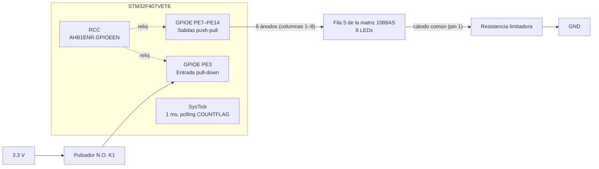
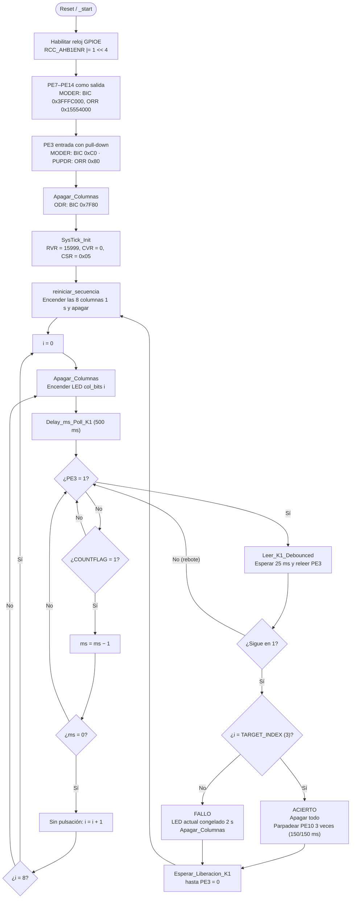

# Reto Unidad 1 — "Ruleta de Precisión" (Tiro al Blanco Visual)

Firmware **bare-metal en ensamblador ARM Thumb-2** para la tarjeta **STM32F407VET6 Black** (Cortex-M4).
El sistema es un probador de reflejos: un único LED recorre un arreglo de 8 LEDs y el usuario debe presionar el pulsador **K1** justo cuando está encendido el LED objetivo.

- **Programa:** [`src/matrix_row5_scan.s`](src/matrix_row5_scan.s)
- **Entorno:** Segger Embedded Studio (SES), sintaxis `unified`, `.thumb`, `.cpu cortex-m4`
- **Sin HAL, SPL ni CMSIS-Driver:** todo el acceso al hardware se hace leyendo y escribiendo directamente las direcciones de los registros.

---

## 1. Estructura del repositorio

```
├── src/
│   └── matrix_row5_scan.s   → programa en ensamblador, comentado
├── docs/                    → fotos del montaje, capturas del depurador, bocetos
├── img/                     → imágenes usadas en este README
└── README.md                → documentación técnica
```

---

## 2. Hardware

### 2.1 Arreglo de 8 LEDs

Los 8 LEDs del barrido son **una sola línea (la fila 5) de la matriz 1088AS**. No se usa la matriz completa ni se multiplexa:

- **Cátodo común:** la fila 5 (pin 1 del display) está cableada fija: `pin 1 → resistencia → GND`. No ocupa ningún pin del microcontrolador.
- **Ánodos:** las 8 columnas de esa fila van a **PE7–PE14** y son **activas en alto**: poner el pin en `1` enciende el LED.
- Las otras 7 filas quedan sin conectar, así que solo esa línea puede encenderse.

Funcionalmente es un arreglo lineal de 8 LEDs controlado pin por pin, igual que con LEDs sueltos.

### 2.2 Asignación de pines

| Columna (posición física) | Índice en el código | Pin del display | Pin del MCU |
|---|---|---|---|
| 1 | 0 | 13 | **PE12** |
| 2 | 1 | 3 | **PE7** |
| 3 | 2 | 4 | **PE8** |
| **4 — LED objetivo** | **3** | **10** | **PE10** |
| 5 | 4 | 6 | **PE9** |
| 6 | 5 | 11 | **PE11** |
| 7 | 6 | 15 | **PE13** |
| 8 | 7 | 16 | **PE14** |
| Fila 5 (cátodo común) | — | 1 | GND (a través de la resistencia) |

| Señal | Pin | Modo | Configuración |
|---|---|---|---|
| Pulsador N.O. K1 | **PE3** | Entrada | Pull-down interna. Presionado = `1` (activo en alto) |

Todo el sistema está en **un solo puerto (GPIOE)**. Así solo se habilita un reloj, y las 8 salidas se encienden o apagan con una sola máscara (`COLS_MASK = 0x7F80`, bits 7–14).

### 2.3 Diagrama de bloques



### 2.4 Resistencia limitadora

Basta **una sola resistencia en el cátodo común** porque el barrido **nunca enciende más de un LED a la vez**. Por ella pasa la corriente de un solo LED, así que se calcula para uno:

$$R = \frac{V_{CC} - V_f}{I} = \frac{3.3\,\text{V} - 2.0\,\text{V}}{I}$$

Con **270 Ω**: $I \approx 4.8\ \text{mA}$. Está dentro del límite del pin del STM32 (≈25 mA) y da brillo suficiente.

> **Única excepción:** al iniciar o reiniciar, la rutina `reiniciar_secuencia` enciende las 8 columnas juntas durante 1 s. En ese momento los 8 LEDs comparten la misma resistencia y se ven más tenues. La corriente total sigue limitada por esa única resistencia, así que no hay riesgo para el microcontrolador.

---

## 3. Cálculos de temporización (SysTick)

### 3.1 Reloj del sistema

El programa **no configura el PLL**, así que el STM32F407 trabaja con el oscilador interno con el que arranca tras el reset, el **HSI de 16 MHz**:

$$f_{CPU} = 16\ \text{MHz} \qquad T_{clk} = \frac{1}{16\times10^{6}} = 62.5\ \text{ns}$$

SysTick se alimenta con el reloj del procesador (`CLKSOURCE = 1`), es decir, también a 16 MHz.

### 3.2 Valor de recarga (`SYSTICK_LOAD`)

SysTick es un contador descendente de 24 bits. Va desde `RVR` hasta 0, y al pasar de 0 se recarga y pone `COUNTFLAG = 1`. Un período completo dura `RVR + 1` ciclos:

$$t_{tick} = \frac{RVR + 1}{f_{CPU}} \quad\Longrightarrow\quad RVR = t_{tick}\cdot f_{CPU} - 1$$

Para una **base de tiempo de 1 ms**:

$$RVR = (1\times10^{-3}\ \text{s})(16\times10^{6}\ \text{Hz}) - 1 = 16\,000 - 1 = 15\,999 = \texttt{0x3E7F}$$

**Verificación:**
- $(15\,999 + 1) \times 62.5\ \text{ns} = 1.000\ \text{ms}$ ✔
- Límite de 24 bits: $15\,999 < 2^{24} - 1 = 16\,777\,215$ ✔
- El período máximo de un solo ciclo a 16 MHz sería $2^{24} / 16\ \text{MHz} \approx 1.05\ \text{s}$. Por eso los tiempos largos (2 s del fallo) se construyen **contando ticks de 1 ms** y no con un solo valor de recarga.

> Si en algún momento se sube el reloj a 168 MHz con el PLL, el valor tendría que ser $RVR = 168\,000 - 1 = 167\,999$ para seguir teniendo 1 ms.

### 3.3 Tiempos del programa

Todos los tiempos salen de contar ticks de 1 ms:

| Constante | Uso | Ticks | Tiempo |
|---|---|---|---|
| `COLUMN_WINDOW_MS` | Tiempo que permanece encendido cada LED del barrido | 500 | **500 ms** |
| — | Vuelta completa del barrido (8 LEDs) | 8 × 500 | **4 s** |
| `K1_DEBOUNCE_CONFIRM_MS` | Espera de confirmación del antirrebote | 25 | **25 ms** |
| — (literal `150`) | Parpadeo de acierto: encendido y luego apagado | 150 + 150 | **300 ms** por parpadeo, **900 ms** los 3 |
| `FALLO_FREEZE_MS` | Congelamiento mostrando el LED erróneo | 2000 | **2 s** |
| — (literal `1000`) | Encendido de las 8 columnas al iniciar o reiniciar | 1000 | **1 s** |

### 3.4 Rutina de espera por sondeo (`Delay_ms`)

```asm
Delay_ms:                       @ R0 = milisegundos a esperar
    PUSH  {R1, R2, LR}
    LDR   R1, =SYST_CSR
dly_wait:
    LDR   R2, [R1]
    TST   R2, #0x00010000       @ bit 16 = COUNTFLAG
    BEQ   dly_wait              @ todavía no se cumple 1 ms
    SUBS  R0, R0, #1            @ se cumplió 1 ms
    BNE   dly_wait
    POP   {R1, R2, LR}
    BX    LR
```

Por hardware, **leer `SYST_CSR` borra `COUNTFLAG`**, así que no hace falta limpiarlo con una escritura. No hay bucles de `NOP` ni de decremento: el tiempo lo define el periférico, sin importar cuántas instrucciones tenga el bucle.

---

## 4. Registro de configuraciones

Todas las escrituras de configuración se hacen como **lectura-modificación-escritura** (`LDR` → `BIC`/`ORR` → `STR`). Así solo cambian los bits de los pines usados y no se alteran los demás bits del registro.

| Periférico | Registro | Dirección base | Offset | Dirección final | Operación en el código | Valor final | Justificación |
|---|---|---|---|---|---|---|---|
| RCC | `AHB1ENR` | `0x4002 3800` | `0x30` | `0x4002 3830` | `ORR #(1<<4)` | `0x0010 0010` | Bit 4 `GPIOEEN = 1`: habilita el reloj de GPIOE. Sin reloj, el puerto no responde. El bit 20 (`CCMDATARAMEN`) ya viene en 1 desde el reset y se conserva. |
| GPIOE | `MODER` | `0x4002 1000` | `0x00` | `0x4002 1000` | `BIC 0x3FFFC000`, `ORR 0x15554000`, `BIC 0x000000C0` | `0x1555 4000` | PE7–PE14 = `01` (salida de propósito general). PE3 = `00` (entrada). |
| GPIOE | `PUPDR` | `0x4002 1000` | `0x0C` | `0x4002 100C` | `BIC 0x000000C0`, `ORR 0x00000080` | `0x0000 0080` | PE3 = `10` (pull-down). El pulsador conecta a 3.3 V, así que en reposo el pin debe leer `0`. PE7–PE14 quedan en `00` (sin pull), porque son salidas. |
| GPIOE | `IDR` | `0x4002 1000` | `0x10` | `0x4002 1010` | Lectura, `LSR #3` y `AND #1` | — | Aísla el bit 3 para saber si K1 está presionado (`1`) o suelto (`0`). |
| GPIOE | `ODR` | `0x4002 1000` | `0x14` | `0x4002 1014` | `ORR` (1 << `col_bits[i]`) para encender. `BIC 0x7F80` para apagar | Varía en ejecución | Controla los 8 ánodos. `0x7F80` = bits 7–14 = las 8 columnas. |
| SysTick | `RVR` (LOAD) | `0xE000 E010` | `0x04` | `0xE000 E014` | `STR 15999` | `0x0000 3E7F` | Período de 1 ms a 16 MHz (ver §3.2). |
| SysTick | `CVR` (VAL) | `0xE000 E010` | `0x08` | `0xE000 E018` | `STR 0` | `0x0000 0000` | Cualquier escritura pone el contador en 0 y borra `COUNTFLAG`, así el conteo arranca limpio. |
| SysTick | `CSR` (CTRL) | `0xE000 E010` | `0x00` | `0xE000 E010` | `STR 0x05` | `0x0000 0005` | Bit 0 `ENABLE = 1`. Bit 1 `TICKINT = 0`, sin interrupción, se usa por sondeo. Bit 2 `CLKSOURCE = 1`, reloj del procesador. |

**Registros que no se modifican** porque su valor de reset ya es el correcto:
- `GPIOE_OTYPER` (offset `0x04`) = `0x0000 0000`: salidas push-pull. El pin entrega corriente activamente al LED.
- `GPIOE_OSPEEDR` (offset `0x08`) = `0x0000 0000`: velocidad baja. Sobra para cambios cada 500 ms y genera menos ruido.

### 4.1 Cómo se obtienen las máscaras de `MODER`

Cada pin usa 2 bits de `MODER`, en las posiciones `[2n+1 : 2n]`.

**Máscara de limpieza (`MODER_CLEAR_MASK`):** `11` en los pines 7 a 14, es decir, bits 14 a 29:

$$\sum_{n=7}^{14} 3 \ll (2n) = \texttt{0x3FFFC000}$$

**Máscara de salida (`MODER_SET_MASK`):** `01` en los mismos pines:

$$\sum_{n=7}^{14} 1 \ll (2n) = \texttt{0x4000} + \texttt{0x10000} + \texttt{0x40000} + \dots + \texttt{0x10000000} = \texttt{0x15554000}$$

**PE3:** bits `[7:6]`, de ahí la máscara `0xC0`. En `PUPDR`, `10` en esos bits es `0x80`.

**Columnas en `ODR` (`COLS_MASK`):** bits 7 a 14 = `0111 1111 1000 0000₂` = `0x7F80`.

### 4.2 Orden de inicialización de SysTick

`SysTick_Init` escribe primero `RVR`, luego `CVR = 0` y por último `CSR`. Si se habilitara antes de cargar `RVR`, el primer período usaría un valor indefinido.

---

## 5. Estrategias de desarrollo

### 5.1 Un solo puerto para todo
Se eligió GPIOE para los LEDs y para el pulsador. Así se habilita un solo reloj en `RCC_AHB1ENR`, y las 8 columnas se configuran y apagan con una sola máscara en lugar de pin por pin.

### 5.2 Traducción de posición a pin (`col_bits`)
El cableado de la matriz no sigue el orden de los bits: la columna 1 está en PE12, la 2 en PE7, etc. Para que el barrido se vea en orden físico, el programa recorre un **índice 0–7** y lo traduce con una tabla en `.rodata`:

```asm
col_bits:
    .byte 12, 7, 8, 10, 9, 11, 13, 14
```

Para encender la columna `i` se usan solo operaciones de bits:

```asm
LDRB  R0, [R4, R5]     @ R0 = col_bits[i]  (número de bit real)
MOV   R1, #1
LSL   R1, R1, R0       @ R1 = 1 << bit     (máscara de ese LED)
ORR   R3, R3, R1       @ se aplica sobre ODR
```

### 5.3 Barrido visual
- Antes de encender cada LED, `Apagar_Columnas` limpia las 8 columnas (`BIC 0x7F80`). Así **siempre hay un solo LED encendido** y no quedan restos del anterior.
- Cada LED permanece **500 ms**, medidos por SysTick. El paso entre LEDs es constante porque no depende de cuántas instrucciones se ejecuten.
- Al llegar al índice 8, vuelve a 0: el barrido va de la columna 1 a la 8 en bucle continuo.

### 5.4 Lectura del pulsador durante el barrido
No se espera los 500 ms "a ciegas". La rutina `Delay_ms_Poll_K1` **revisa K1 continuamente** mientras cuenta los ticks de la ventana del LED. Si se confirma una pulsación, corta la espera y retorna `R0 = 1`. Si se acaba el tiempo sin pulsación, retorna `R0 = 0`. Así el juego responde en el instante exacto en que se presiona, no al final de la ventana.

### 5.5 Antirrebote (debouncing)
Un pulsador mecánico rebota durante unos milisegundos al cerrarse, y sin filtro una sola pulsación podría leerse como varias.

1. Al ver el primer `1` en PE3, se llama a `Leer_K1_Debounced`.
2. Esta rutina espera **25 ms con SysTick**, más que el tiempo típico de rebote, y **vuelve a leer** el pin.
3. Si sigue en `1`, es una pulsación real y retorna `R0 = 1`. Si ya volvió a `0`, fue rebote o ruido: retorna `R0 = 0` y el barrido continúa como si nada.

### 5.6 Evitar pulsaciones "arrastradas"
Después de un acierto o un fallo, `Esperar_Liberacion_K1` **espera a que el usuario suelte el botón** antes de reiniciar. Sin esto, si el usuario mantiene presionado, la misma pulsación se detectaría apenas arranque la nueva partida. Los rebotes al soltar no causan problema porque el reinicio empieza con 1 s de espera.

### 5.7 Resolución de la partida
- **Acierto** (índice = `TARGET_INDEX` = 3 → columna 4 → PE10): el barrido se detiene, se apaga todo y **solo el LED objetivo parpadea 3 veces** (150 ms encendido y 150 ms apagado).
- **Fallo:** no se apaga nada. El LED que estaba encendido al presionar **queda congelado 2 s** y luego la secuencia se reinicia sola.
- **Reinicio:** al empezar cada partida se encienden las 8 columnas durante 1 s como señal de "listo", se apagan y arranca el barrido.

### 5.8 Problemas encontrados y soluciones

| Problema | Causa | Solución |
|---|---|---|
| El programa no arrancaba | SES busca el símbolo `_start` como punto de entrada, no `main` | Etiqueta de entrada `_start` declarada con `.global` |
| La tabla leía valores basura | Estaba en `.data`, que necesita copiarse de flash a RAM en el arranque | Se movió `col_bits` a `.rodata`, que se lee directo de flash |
| El barrido salía en desorden | Las columnas de la matriz no están en orden de bits | Tabla de traducción `col_bits` |
| `Leer_K1_Debounced` devolvía un valor incorrecto | El `POP {R0, ...}` restauraba el R0 viejo encima del resultado | El valor de retorno se carga en R0 **después** del `POP` |
| La misma pulsación disparaba dos partidas | El botón seguía presionado al reiniciar | Rutina `Esperar_Liberacion_K1` |

### 5.9 Resultado de las pruebas en hardware

> ⚠️ **El sistema no funcionó completamente.**

| Función | Resultado |
|---|---|
| Inicialización (LEDs apagados, encendido de las 8 columnas 1 s) | ✔ Funciona |
| Barrido de los 8 LEDs con SysTick (500 ms por LED) | ✔ Funciona |
| Detección del pulsador K1 | ✘ **No funciona**: al presionar K1 la ruleta sigue girando como si no se hubiera presionado |
| Acierto (parpadeo ×3) y fallo (congelamiento 2 s) | ✘ No se pudieron probar, porque dependen de la detección de K1 |
| Botón RST de la placa | ✔ Reinicia el microcontrolador y el programa arranca de nuevo |

**Causa probable.** El programa supone que K1 es **activo en alto**: configura PE3 con pull-down y espera leer `1` al presionar. En la tarjeta STM32F407VET6 Black, los pulsadores K0 (PE4) y K1 (PE3) suelen estar conectados **entre el pin y GND**, es decir, son **activos en bajo**. Si es así:

- Al presionar K1, el pin se conecta a GND y lee `0`.
- Con el botón suelto, la pull-down también deja el pin en `0`.
- El pin **siempre lee `0`**, la condición `PE3 = 1` nunca se cumple y el barrido nunca se detiene.

Esto coincide con lo observado: el barrido funciona normal y solo el botón RST, que actúa directamente sobre el pin NRST del microcontrolador, tiene efecto.

**Cómo verificarlo:**
1. En el depurador de SES, pausar el programa y observar el bit 3 de `GPIOE_IDR` (`0x4002 1010`) con K1 suelto y luego presionado.
2. O medir con el multímetro el voltaje de PE3 respecto a GND en ambos estados.

Si el bit no cambia nunca de `0`, se confirma que el botón es activo en bajo.

**Corrección propuesta** (sin cambiar la lógica del juego):

| Cambio | Antes | Después |
|---|---|---|
| `K1_PUPDR_DOWN` → pull-up en PE3 | `0x00000080` (`10` = pull-down) | `0x00000040` (`01` = pull-up) |
| `Delay_ms_Poll_K1`: condición de pulsación | `CMP R3, #1` / `BNE poll_no_press` | `CMP R3, #0` / `BNE poll_no_press` |
| `Leer_K1_Debounced`: confirmación | `CMP R1, #1` / `BEQ debounce_confirmado` | `CMP R1, #0` / `BEQ debounce_confirmado` |
| `Esperar_Liberacion_K1`: botón suelto | `CMP R0, #0` (espera mientras sea `1`) | `CMP R0, #1` (espera mientras sea `0`) |

Otra opción es usar un **pulsador externo N.O.** (como pide el enunciado) conectado entre PE3 y 3.3 V. En ese caso el código actual, con pull-down y activo en alto, sí es correcto tal como está.

### 5.10 Evidencias
En `docs/` se incluyen fotos del montaje, capturas del depurador de SES con los registros de GPIOE y SysTick, y el video del funcionamiento.

---

## 6. Diagrama de flujo


