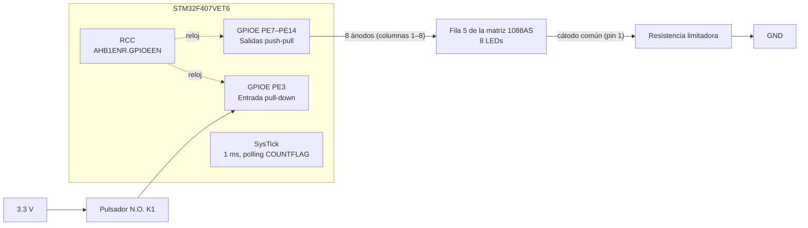
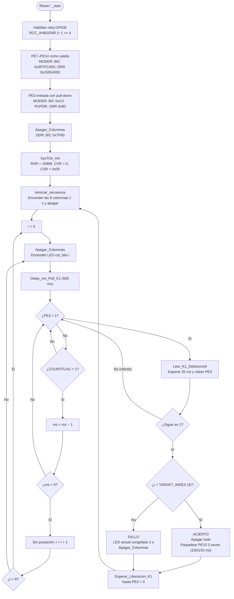

# Diagramas — Reto Unidad 1 "Ruleta de Precisión"

Diagramas del proyecto en formato Mermaid (GitHub los muestra directamente). La explicación completa está en el [README](../README.md).

## Diagrama de bloques del hardware

## Diagrama de flujo del software

